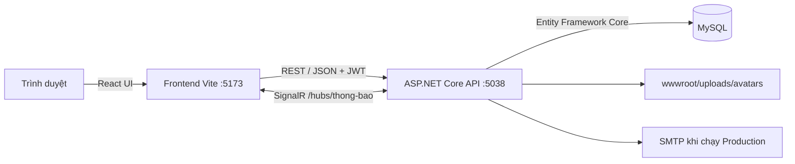

# Đặt Món Ăn Online

Đây là hệ thống đặt món ăn trực tuyến gồm website cho khách hàng, khu vực quản lý nhà hàng và trang quản trị hệ thống. Dự án được xây dựng theo mô hình frontend React giao tiếp với ASP.NET Core Web API, sử dụng MySQL để lưu dữ liệu và SignalR để gửi thông báo theo thời gian thực.

README này dành cho cả người chưa biết dự án. Chỉ cần làm lần lượt phần **Cài đặt và chạy dự án** là có thể khởi động hệ thống ở máy local.

## Mục lục

- [Chức năng chính](#chức-năng-chính)
- [Luồng hoạt động](#luồng-hoạt-động)
- [Công nghệ sử dụng](#công-nghệ-sử-dụng)
- [Kiến trúc hệ thống](#kiến-trúc-hệ-thống)
- [Cấu trúc thư mục](#cấu-trúc-thư-mục)
- [Yêu cầu môi trường](#yêu-cầu-môi-trường)
- [Cài đặt và chạy dự án](#cài-đặt-và-chạy-dự-án)
- [Cấu hình](#cấu-hình)
- [Database](#database)
- [API và phân quyền](#api-và-phân-quyền)
- [Quy tắc nghiệp vụ quan trọng](#quy-tắc-nghiệp-vụ-quan-trọng)
- [Kiểm tra trước khi commit](#kiểm-tra-trước-khi-commit)
- [Lỗi thường gặp](#lỗi-thường-gặp)
- [Lưu ý khi triển khai thật](#lưu-ý-khi-triển-khai-thật)

## Chức năng chính

Hệ thống có 3 vai trò: `KhachHang`, `Quan` và `Admin`.

### Khách hàng

- Đăng ký, đăng nhập và đăng xuất.
- Quên mật khẩu bằng mã xác nhận; đổi mật khẩu khi đang đăng nhập.
- Cập nhật hồ sơ và ảnh đại diện.
- Xem, tìm kiếm và lọc nhà hàng.
- Xem chi tiết nhà hàng, thực đơn, topping, đánh giá và voucher.
- Thêm món vào giỏ khi chưa đăng nhập; giỏ khách được lưu ở trình duyệt.
- Đồng bộ giỏ khách lên tài khoản sau khi đăng nhập.
- Quản lý nhiều địa chỉ giao hàng và chọn địa chỉ mặc định.
- Lưu voucher vào kho voucher và chọn voucher phù hợp khi thanh toán.
- Thanh toán bằng COD hoặc mô phỏng Momo, VNPay, ZaloPay qua mã QR.
- Theo dõi riêng trạng thái thanh toán và trạng thái xử lý đơn.
- Xem lịch sử trạng thái, hủy đơn khi còn được phép và đánh giá sau khi hoàn thành.
- Nhận thông báo cập nhật đơn hàng theo thời gian thực.

### Chủ nhà hàng (`Quan`)

- Đăng ký nhà hàng và chờ quản trị viên duyệt.
- Xem tổng quan hoạt động của quán.
- Cập nhật thông tin, giờ mở cửa, phí giao hàng và trạng thái nhận đơn.
- Quản lý danh mục và thứ tự danh mục.
- Quản lý món ăn, trạng thái bán và nhóm topping.
- Quản lý topping và gán nhóm topping cho món.
- Tạo, sửa và bật/tắt khuyến mãi của quán.
- Xem đơn hàng, phân trang, lọc và chuyển trạng thái đúng thứ tự.
- Chỉ xử lý đơn online sau khi thanh toán thành công; tránh thu tiền lần hai.
- Nhận đơn mới và thông báo qua SignalR.

### Quản trị viên (`Admin`)

- Xem thống kê tổng quan và nhà hàng nổi bật.
- Xem danh sách tài khoản theo role và trạng thái.
- Khóa hoặc mở khóa tài khoản.
- Duyệt hoặc từ chối nhà hàng mới.
- Quản lý voucher cấp hệ thống.
- Xem dữ liệu đơn hàng toàn hệ thống.
- Nhận và quản lý thông báo.

## Luồng hoạt động

### Luồng đặt món

1. Khách chọn một nhà hàng và thêm món/topping vào giỏ.
2. Các dòng có cùng món, cùng topping và cùng ghi chú được gộp số lượng.
3. Khách có thể tạo giỏ khi chưa đăng nhập.
4. Khi bấm thanh toán, hệ thống yêu cầu đăng nhập nếu chưa có phiên.
5. Giỏ khách được đồng bộ lên tài khoản.
6. Khách chọn địa chỉ, phương thức thanh toán, voucher và nhập ghi chú.
7. Backend kiểm tra lại giá, trạng thái quán, món, voucher và quyền sở hữu giỏ.
8. Đơn được tạo với snapshot tên nhà hàng, tên món và topping tại thời điểm đặt.
9. COD chuyển sang chờ quán xác nhận. Đơn online phải thanh toán thành công trước khi quán xử lý.
10. Quán cập nhật lần lượt: `ChoXacNhan` → `DaXacNhan` → `DangChuanBi` → `DangGiao` → `HoanThanh`.
11. Khách theo dõi đơn, nhận thông báo và đánh giá khi đơn hoàn thành.

### Trạng thái thanh toán và trạng thái đơn

Hai loại trạng thái độc lập, không được hiểu là một:

- Trạng thái đơn: quán đã xác nhận hay đang chuẩn bị/giao món đến đâu.
- Trạng thái thanh toán: khách đã trả tiền hay chưa.

Ví dụ `Đã thanh toán • Chờ quán xác nhận` là trạng thái hợp lệ.

## Công nghệ sử dụng

### Backend

- ASP.NET Core Web API, target framework `.NET 10`.
- Entity Framework Core 9 và `Pomelo.EntityFrameworkCore.MySql`.
- MySQL.
- JWT Bearer Authentication và phân quyền theo role.
- SignalR cho thông báo thời gian thực.
- OpenAPI và Scalar API Reference trong môi trường Development.
- In-memory cache cho OTP, khóa đăng nhập tạm thời và giữ giỏ khi checkout.
- Background service tự hủy đơn online quá hạn.

### Frontend

- React 19.
- TypeScript 6.
- Vite 8.
- React Router 7.
- SignalR client.
- Lucide React cho icon.
- Font Be Vietnam Pro.
- CSS thuần với responsive layout và scroll animation.

## Kiến trúc hệ thống



- Frontend không truy cập database trực tiếp.
- Mọi kiểm tra quyền, giá tiền và trạng thái nghiệp vụ phải được thực hiện lại ở backend.
- JWT được gửi trong header `Authorization: Bearer <token>`.
- SignalR dùng cùng token để xác thực kết nối thông báo.

## Cấu trúc thư mục

```text
DatMonAnOnline/
├── DatMonAnOnline.API/             # Backend ASP.NET Core
│   ├── Common/                     # Phân trang IQueryable và kiểu PagedResult
│   ├── Controllers/                # REST API theo từng nghiệp vụ
│   ├── Data/                       # Thành phần truy cập dữ liệu bổ sung
│   ├── Database/Database.sql       # Script khởi tạo database
│   ├── DTOs/                       # Kiểu dữ liệu request/response
│   ├── Hubs/NotificationHub.cs     # SignalR hub
│   ├── Models/                     # Entity và DbContext
│   ├── Security/                   # Version token và policy rate limit
│   ├── Services/                   # Email, realtime, timeout thanh toán...
│   ├── wwwroot/uploads/avatars/    # Ảnh đại diện tải lên
│   ├── Program.cs                  # DI, middleware, CORS, JWT, OpenAPI
│   └── appsettings.json            # Connection string và SMTP
├── FE/                             # Frontend React
│   ├── src/components/             # Component tái sử dụng
│   ├── src/pages/                  # Các trang theo role
│   ├── src/services/               # Hàm gọi API và SignalR
│   ├── src/App.tsx                 # Khai báo route
│   └── src/App.css                 # Style toàn ứng dụng
├── postman/                        # Tài nguyên Postman của workspace
├── DatMonAnOnline.slnx             # Solution .NET
└── README.md
```

## Yêu cầu môi trường

Cài các công cụ sau trước khi chạy:

- Git.
- .NET SDK 10.
- Node.js `^20.19.0` hoặc `>=22.12.0`.
- npm (được cài cùng Node.js).
- MySQL 8.x. Có thể dùng MySQL trong XAMPP nếu cấu hình tương thích.
- Công cụ import SQL: phpMyAdmin, MySQL Workbench hoặc MySQL CLI.

Kiểm tra phiên bản:

```powershell
dotnet --version
node --version
npm --version
mysql --version
```

## Cài đặt và chạy dự án

### 1. Lấy source code

```powershell
git clone <repository-url>
cd DatMonAnOnline
```

Nếu đã có source thì chỉ cần mở terminal tại thư mục gốc dự án.

### 2. Tạo database

Khởi động MySQL, sau đó import file:

```text
DatMonAnOnline.API/Database/Database.sql
```

Cách dễ nhất với phpMyAdmin:

1. Mở phpMyAdmin.
2. Chọn **Import**.
3. Chọn `DatMonAnOnline.API/Database/Database.sql`.
4. Bấm **Import/Go** và chờ hoàn tất.

Hoặc dùng MySQL CLI trong Command Prompt:

```bat
mysql -u root -p < DatMonAnOnline.API\Database\Database.sql
```

> Tên database trong connection string phải trùng tên database vừa import. Cấu hình local hiện tại dùng `DatMonAnOnline_Benchmark`; hãy đổi lại nếu database của bạn có tên khác.

### 3. Cấu hình kết nối MySQL

Mở `DatMonAnOnline.API/appsettings.json` và sửa `DefaultConnection`:

```json
{
  "ConnectionStrings": {
    "DefaultConnection": "Server=localhost;Port=3306;Database=DatMonAnOnline_Benchmark;Uid=root;Pwd=<mat-khau-mysql>;"
  }
}
```

Không commit mật khẩu thật. Có thể ghi đè bằng biến môi trường PowerShell:

```powershell
$env:ConnectionStrings__DefaultConnection="Server=localhost;Port=3306;Database=DatMonAnOnline_Benchmark;Uid=root;Pwd=<mat-khau-mysql>;"
```

### 4. Chạy backend

Mở terminal thứ nhất tại thư mục gốc:

```powershell
dotnet restore .\DatMonAnOnline.API\DatMonAnOnline.API.csproj
dotnet run --project .\DatMonAnOnline.API\DatMonAnOnline.API.csproj
```

Backend mặc định chạy tại:

```text
http://localhost:5038
```

Trong Development:

- OpenAPI JSON: `http://localhost:5038/openapi/v1.json`
- Scalar API UI: `http://localhost:5038/scalar/v1`

### 5. Chạy frontend

Mở terminal thứ hai:

```powershell
cd FE
npm ci
npm run dev
```

Mở trình duyệt tại:

```text
http://localhost:5173
```

Frontend hiện gọi API ở `http://localhost:5038/api`, được khai báo trong `FE/src/services/api.ts`.

### 6. Kiểm tra nhanh

1. Mở trang chủ và kiểm tra danh sách nhà hàng.
2. Đăng ký một tài khoản khách hàng.
3. Thêm món vào giỏ, đăng nhập và chuyển sang thanh toán.
4. Tạo địa chỉ giao hàng.
5. Đặt thử đơn COD.
6. Đăng nhập role quán để xác nhận và chuyển trạng thái đơn.

Database có thể chứa dữ liệu mẫu, nhưng README không cố định tài khoản/mật khẩu demo. Hãy dùng tài khoản do nhóm cung cấp hoặc đăng ký tài khoản mới.

## Cấu hình

### Backend

Các cấu hình quan trọng nằm trong `DatMonAnOnline.API/appsettings.json`:

| Cấu hình | Ý nghĩa |
|---|---|
| `ConnectionStrings:DefaultConnection` | Kết nối MySQL |
| `Email:Smtp:Host` | SMTP server |
| `Email:Smtp:Port` | Cổng SMTP, thường là 587 |
| `Email:Smtp:EnableSsl` | Bật TLS/SSL |
| `Email:Smtp:UserName` | Tài khoản SMTP |
| `Email:Smtp:Password` | Mật khẩu/app password |
| `Email:Smtp:FromAddress` | Địa chỉ người gửi |
| `Email:Smtp:FromName` | Tên hiển thị người gửi |

### Email quên mật khẩu

Trong `Development`, API trả thêm `maXacNhanThuNghiem`. Nhờ đó có thể test quên mật khẩu mà không cần email thật.

Trong `Production`, API không trả mã ra response và yêu cầu SMTP hợp lệ. Nên dùng biến môi trường:

```powershell
$env:ASPNETCORE_ENVIRONMENT="Production"
$env:Email__Smtp__Host="smtp.gmail.com"
$env:Email__Smtp__Port="587"
$env:Email__Smtp__EnableSsl="true"
$env:Email__Smtp__UserName="your-email@gmail.com"
$env:Email__Smtp__Password="your-app-password"
$env:Email__Smtp__FromAddress="your-email@gmail.com"
$env:Email__Smtp__FromName="Đặt Món Ăn"

dotnet run --no-launch-profile `
  --project .\DatMonAnOnline.API\DatMonAnOnline.API.csproj `
  --urls http://localhost:5038
```

Với Gmail, nên bật xác minh hai bước và dùng **App Password**, không dùng mật khẩu Gmail chính.

### CORS và port

Backend đang cho phép frontend từ:

- `http://localhost:5173`
- `http://localhost:5174`

Nếu frontend chạy port/domain khác, cập nhật policy `AllowFrontend` trong `Program.cs`.

### Ảnh đại diện

- Chấp nhận JPEG, PNG và WebP.
- Kích thước tối đa 5 MB.
- Backend kiểm tra cả MIME type và chữ ký file.
- File được lưu tại `DatMonAnOnline.API/wwwroot/uploads/avatars`.
- Khi deploy, thư mục upload cần quyền ghi và volume lưu trữ bền vững.

## Database

### Nguồn schema

Source hiện tại dùng file sau làm nguồn khởi tạo database:

```text
DatMonAnOnline.API/Database/Database.sql
```

Đây là dự án database-first; repository hiện không có thư mục EF Core `Migrations` hoặc `DatabaseMigrations`. Không chạy `dotnet ef database update` nếu chưa tự tạo migration tương ứng.

Nếu nâng cấp một database cũ:

1. Sao lưu database trước.
2. So sánh schema cũ với `Database.sql` hiện tại.
3. Bổ sung các bảng/cột còn thiếu hoặc import vào database mới.
4. Kiểm tra dữ liệu trước khi trỏ ứng dụng sang database mới.

### Các nhóm bảng chính

| Nhóm | Bảng tiêu biểu |
|---|---|
| Tài khoản | `taikhoan`, `role`, `khachhang`, `nhahang` |
| Danh mục món | `danhmuc`, `monan`, `nhomtopping`, `topping`, `monan_nhomtopping` |
| Giỏ hàng | `giohang`, `chitietgiohang`, `chitietgiohang_topping` |
| Đơn hàng | `donhang`, `chitietdonhang`, `chitietdonhang_topping`, `lichsutrangthaidonhang` |
| Thanh toán | `phuongthucthanhtoan`, `thanhtoan`, `hoantien` |
| Khuyến mãi | `khuyenmai`, `khachhang_khuyenmai` |
| Khác | `diachi`, `thongbao`, `danhgiamonan`, `danhgianhahang` |

### Phương thức và trạng thái chuẩn

Phương thức thanh toán:

- `COD`
- `Momo`
- `VNPay`
- `ZaloPay`

Trạng thái đơn theo thứ tự:

1. `ChoXacNhan`
2. `DaXacNhan`
3. `DangChuanBi`
4. `DangGiao`
5. `HoanThanh`
6. `DaHuy`

Không tự ý đổi chuỗi trạng thái trong database nếu chưa cập nhật cả backend và frontend.

## API và phân quyền

Base URL:

```text
http://localhost:5038/api
```

### Các nhóm endpoint

| Nhóm | Route chính | Quyền |
|---|---|---|
| Xác thực | `/api/auth/*` | Công khai hoặc đã đăng nhập |
| Nhà hàng công khai | `/api/nha-hang`, `/api/nha-hang/{id}` | Công khai |
| Hồ sơ nhà hàng | `/api/nha-hang/ho-so` | `Quan` |
| Danh mục | `/api/danh-muc/*` | GET công khai, ghi dữ liệu: `Quan` |
| Món ăn | `/api/mon-an/*` | GET công khai, ghi dữ liệu: `Quan` |
| Topping | `/api/topping/*`, `/api/nhom-topping/*` | `Quan` cho quản lý |
| Giỏ hàng | `/api/gio-hang/*` | `KhachHang` |
| Địa chỉ | `/api/dia-chi/*` | `KhachHang` |
| Đặt hàng | `/api/don-hang/*` | Theo chủ sở hữu và role |
| Đơn của quán | `/api/nha-hang/don-hang` | `Quan` |
| Thanh toán | `/api/thanh-toan/*` | Theo chủ sở hữu và role |
| Voucher | `/api/khuyen-mai/*` | Tùy endpoint |
| Đánh giá | `/api/danh-gia-*` | Khách đã mua; GET công khai |
| Thông báo | `/api/thong-bao/*` | Đã đăng nhập |
| Quản trị | `/api/admin/*` | `Admin` |
| Realtime hub | `/hubs/thong-bao` | Đã đăng nhập |

### Phân trang

Các API danh sách lớn dùng LINQ trên `IQueryable` và nhận:

```text
pageNumber=1&pageSize=12
```

- `pageNumber` bắt đầu từ 1.
- `pageSize` từ 1 đến 100.
- Response gồm `items`, `pageNumber`, `pageSize`, `totalItems`, `totalPages`, `hasPreviousPage`, `hasNextPage`.

### Ví dụ đăng nhập

```bash
curl -X POST http://localhost:5038/api/auth/login \
  -H "Content-Type: application/json" \
  -d '{"email":"user@example.com","matKhau":"your-password"}'
```

Gọi endpoint cần đăng nhập:

```bash
curl "http://localhost:5038/api/don-hang/cua-toi?pageNumber=1&pageSize=8" \
  -H "Authorization: Bearer <token>"
```

## Quy tắc nghiệp vụ quan trọng

### Tài khoản và bảo mật

- Mật khẩu được hash bằng PBKDF2-SHA256 với salt riêng và 100.000 vòng lặp.
- JWT có hiệu lực 24 giờ.
- Backend kiểm tra tài khoản còn hoạt động và kiểm tra version mật khẩu ở mỗi request.
- Đổi/reset mật khẩu làm toàn bộ token cũ mất hiệu lực.
- Sai đăng nhập 5 lần sẽ khóa thử đăng nhập trong 15 phút.
- Login giới hạn 10 request/phút/IP.
- Yêu cầu OTP giới hạn 3 request/15 phút/IP.
- Xác nhận OTP giới hạn 10 request/10 phút/IP.
- OTP gồm 6 số, có hiệu lực 10 phút và bị hủy sau 5 lần nhập sai.
- Response quên mật khẩu không tiết lộ email có tồn tại hay không.

### Giỏ hàng

- Có thể thêm món khi chưa đăng nhập.
- Giỏ khách được lưu trong `localStorage` với TTL 5 phút không hoạt động.
- Giỏ tài khoản cũng hết hạn sau 5 phút không hoạt động.
- Khi đã vào checkout, giỏ được giữ tối đa 30 phút để người dùng nhập thông tin.
- Các món giống nhau chỉ gộp khi món, topping và ghi chú hoàn toàn giống nhau.
- Mỗi giỏ thuộc một nhà hàng; dữ liệu giá được backend tính lại.

### Voucher

- Khách phải lưu voucher trước thì voucher mới xuất hiện trong kho/chọn nhanh khi checkout.
- Checkout chỉ hiển thị voucher hệ thống và voucher đúng nhà hàng đang đặt.
- Vẫn có thể nhập mã được chia sẻ thủ công.
- Backend kiểm tra phạm vi áp dụng, thời hạn, số lượng, giá trị đơn tối thiểu và giới hạn giảm.
- Voucher của đơn online quá hạn được hoàn lại lượt sử dụng khi hệ thống tự hủy đơn.

### Thanh toán

- COD được thu khi giao và được đánh dấu thành công khi đơn hoàn thành.
- Momo, VNPay và ZaloPay hiện là **thanh toán mô phỏng**, chưa kết nối cổng thật.
- Đơn online chưa thanh toán không được chuyển trạng thái bởi quán.
- Đơn online chờ thanh toán quá 15 phút được background service tự hủy.
- Người dùng có thể thử lại/đổi phương thức sau một giao dịch thất bại theo quy tắc backend.

### Lịch sử đơn hàng

- Tên nhà hàng, món và topping được snapshot lúc đặt để hóa đơn cũ không thay đổi khi dữ liệu thực đơn bị sửa.
- Mọi lần đổi trạng thái được ghi vào lịch sử.
- Lịch sử có thể do tài khoản thao tác hoặc do hệ thống tự động tạo.

## Kiểm tra trước khi commit

### Backend

```powershell
dotnet build .\DatMonAnOnline.API\DatMonAnOnline.API.csproj
```

### Frontend

```powershell
cd FE
npm run lint
npm run build
```

Hiện repository chưa có project test tự động riêng. Sau khi build, nên kiểm thử thủ công ít nhất các luồng:

- Đăng ký/đăng nhập/quên mật khẩu.
- Thêm giỏ khi chưa đăng nhập và đồng bộ sau đăng nhập.
- Đặt COD và thanh toán QR mô phỏng.
- Quán nhận đơn và chuyển trạng thái.
- Hủy đơn, hoàn lượt voucher và hiển thị lịch sử.
- Phân trang ở cả ba role.
- Thông báo SignalR.

## Lỗi thường gặp

### Frontend báo `Failed to fetch`

- Kiểm tra backend có chạy ở `http://localhost:5038` không.
- Kiểm tra `API_URL` trong `FE/src/services/api.ts`.
- Kiểm tra frontend có chạy ở port được CORS cho phép không.

### API trả 401

- Token thiếu, hết hạn, tài khoản bị khóa hoặc mật khẩu đã đổi.
- Đăng xuất, đăng nhập lại và thử lại.
- Kiểm tra role có quyền gọi endpoint hay không.

### API trả 500 hoặc báo thiếu bảng/cột

- Kiểm tra connection string có trỏ đúng database không.
- Import lại `Database.sql` vào database mới để đối chiếu.
- Không hiển thị stack trace database trực tiếp cho người dùng ở Production.

### Không kết nối được MySQL

- Kiểm tra MySQL đang chạy.
- Kiểm tra port, username, password và tên database.
- Với XAMPP, port có thể khác 3306 nếu máy đã cài một MySQL khác.

### Quên mật khẩu không gửi email

- Development dùng `maXacNhanThuNghiem`, không gửi SMTP thật.
- Production cần đủ biến `Email__Smtp__*`.
- Kiểm tra App Password, cổng 587 và TLS nếu dùng Gmail.

### Ảnh đại diện không hiện

- Backend phải đang chạy vì ảnh được phục vụ từ `wwwroot` của API.
- Kiểm tra quyền ghi thư mục `wwwroot/uploads/avatars`.
- Chỉ dùng JPEG, PNG hoặc WebP không quá 5 MB.

### Console báo lỗi `M_ID` trong `200.js`

Đây thường là script được extension Urban VPN chèn vào trang, không phải file của dự án. Hãy tắt extension cho `localhost`, mở cửa sổ InPrivate hoặc gỡ extension rồi tải lại bằng `Ctrl + F5`.

### Port đang được sử dụng

Đổi port backend:

```powershell
dotnet run --project .\DatMonAnOnline.API\DatMonAnOnline.API.csproj --urls http://localhost:5040
```

Sau đó phải cập nhật `API_URL` ở frontend và CORS ở backend cho đồng bộ.

## Lưu ý khi triển khai thật

Phiên bản hiện tại phù hợp cho đồ án và môi trường local. Trước khi dùng Production cần xử lý thêm:

- Không để JWT secret trong source; chuyển sang biến môi trường hoặc secret manager.
- Không commit connection string, mật khẩu database và SMTP.
- Bật HTTPS thật và cấu hình domain CORS chính xác.
- Đổi `API_URL` hard-code thành biến môi trường Vite như `VITE_API_URL`.
- Tích hợp SDK/webhook chính thức của Momo, VNPay hoặc ZaloPay; xác minh chữ ký và chống xử lý giao dịch lặp.
- Dùng Redis/distributed cache nếu chạy nhiều API instance. OTP và giữ giỏ checkout hiện nằm trong memory của một process.
- Lưu avatar trên object storage hoặc volume bền vững khi chạy container/cloud.
- Thiết lập backup database, log tập trung và giám sát background service.
- Bổ sung automated test cho auth, quyền truy cập, voucher, thanh toán và chuyển trạng thái đơn.
- Rà soát lại dữ liệu mẫu trước khi public repository.

## Đóng góp

Quy trình đề xuất:

1. Tạo branch theo chức năng hoặc lỗi.
2. Không sửa/xóa API hoặc schema ngoài phạm vi task nếu chưa trao đổi với nhóm.
3. Build backend, lint và build frontend trước khi commit.
4. Commit ngắn gọn, mô tả đúng thay đổi.
5. Nếu thay đổi database, cập nhật `Database.sql` và README trong cùng commit.

Ví dụ commit:

```text
feat: bổ sung kho voucher và chọn voucher khi thanh toán
fix: sửa truy vấn phân trang danh sách đơn hàng khách hàng
docs: cập nhật hướng dẫn cài đặt và vận hành dự án
```
